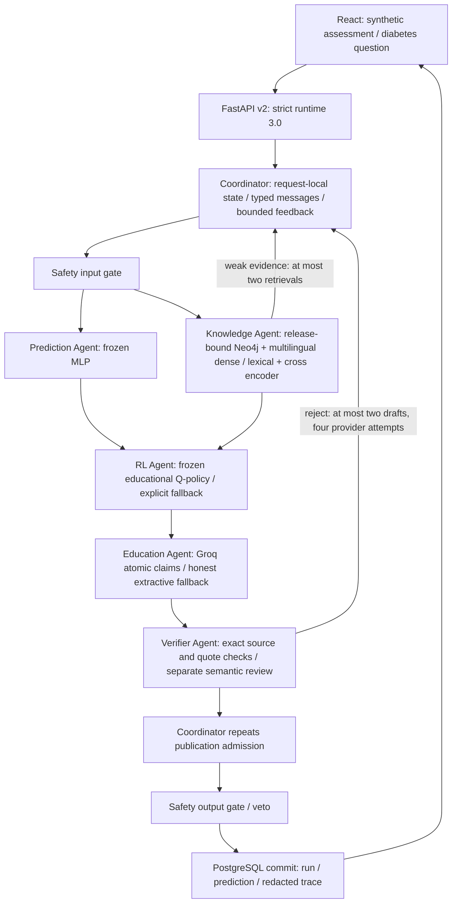
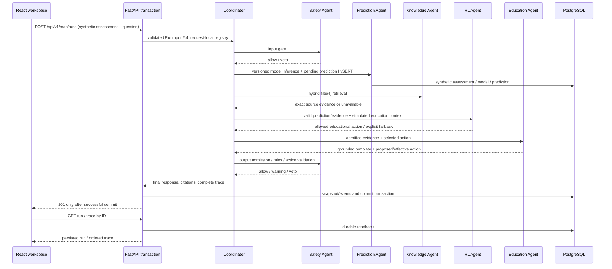
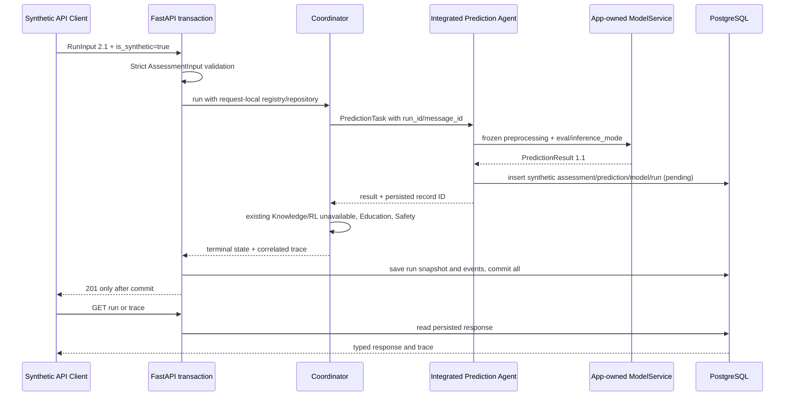
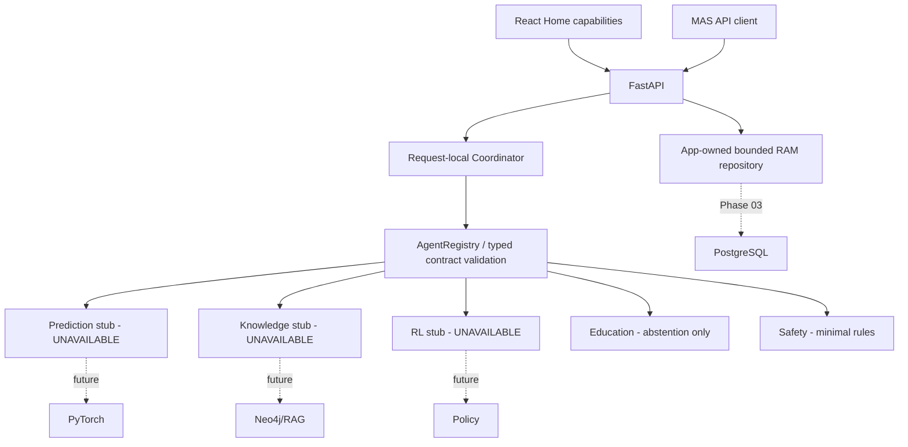
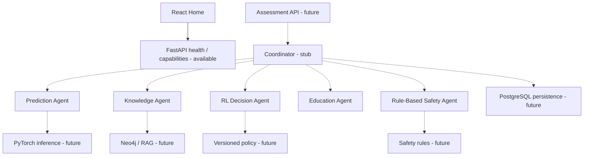

# Current architecture — grounded diabetes expansion, runtime 3.0

User-authorized expansion before Phase 08. React now calls `/api/v2` with six typed agents. `/api/v1` retains runtime 2.4 and old persisted responses. This adds no SQL DDL migration, local LLM training or production deployment. [ADR 0007](decisions/0007-diabetes-grounded-llm-runtime.md), [grounding and failure rules](llm_grounding.md), [data catalog](diabetes_data_catalog.md), [current reproduction guide](diabetes_expansion_demo.md).

Graph contains a versioned 14-page NIDDK corpus and separately source-supported diabetes relations. No vector-only fallback pretends Neo4j is available. Public source content is prepared explicitly; requests never download model weights or follow model-selected URLs. The pretrained multilingual encoder and reranker run on CPU. Groq receives redacted question plus admitted public evidence, never raw assessment features or credentials. Provider availability requires a real successful call; missing key is visible as unavailable.

Verifier is an additional agent with distinct contract and authority to reject drafts; Coordinator can repair from reason codes or choose exact-source fallback. Semantic review uses a separate call to the same provider and remains fallible. Both deterministic publication admission and mandatory Safety remain independent of a model's self-assessment. RL recommendation/effective response action and overrides are explicit. Messages and task deadlines are per run; raw rejected drafts are erased. Full sequence is post-run inspection, not streaming, and conversation memory is not implemented.

# Phase 07 architecture (historical runtime 2.4)

React/TypeScript/Vite local workspace calls the existing runtime 2.4 MAS API and reads persisted runs/trace from PostgreSQL. Five screens cover Overview/dependency readiness, synthetic Assessment, Knowledge assistant, Execution monitor and Experiments. Agent registry, permissions, model, RL policy and Safety contract stay as Phase 06; no clinical agent or online training added.

Early veto skips business agents and still records output Safety gate. Missing model/Neo4j returns declared degraded behavior, no substitute output/citation; missing SQL aborts with sanitized 503. Execution monitor is post-run inspection, not streaming. UI renders only allowlisted metadata summaries; it does not expose raw assessment/prompt/candidate or arbitrary JSON dumps.

`GET /api/v1/system/readiness` probes SQL migration/storage, graph connectivity/counts, model and policy artifacts; `/health` remains liveness. Existing capabilities now uses actual probes. `GET /api/v1/experiments` and `/{name}/figure` serve only complete checksum-verified experiment bundles. Runtime/output schema versions unchanged; no DDL migration. E1–E5 scripts are offline evaluation tools; isolated fault app is only a local QA entry point. See demo_guide.md and experiments.md. Older current-state headings below describe historical phases.

# Phase 06 architecture (historical)

Integrated RLDecisionAgent loads the offline notebook-trained educational Q-table and selects one whitelisted next interaction. Coordinator passes simulated context explicitly and preserves Safety veto. Education uses the selected action; PostgreSQL persists RL metadata in existing snapshot/event JSON. No online learning or clinical actions. See rl_mdp.md and rl_experiments.md. Older stub descriptions below are historical.

# Phase 05 current architecture

Mandatory two-stage Rule-Based SafetyAgent now gates Coordinator business dispatch and final response. Versioned deterministic engine, provenance admission and fail-closed handling; no DL/RL changes. [Safety sequence/policy](safety_policy.md), [ADR 0004](decisions/0004-safety-policy.md). Older phase descriptions follow as history.

# Phase 04 current architecture

Default registry now uses integrated KnowledgeAgent → hybrid Neo4j retrieval and deterministic grounded EducationAgent. Prediction weights and PostgreSQL transaction path unchanged; RL stays stub. See [knowledge graph](knowledge_graph.md) and [RAG sequence](rag_pipeline.md). Phase 03 statements below that knowledge is stub are historical.

# Current architecture — Phase 03

Default main:app uses real Phase 02 MLP and PostgreSQL. Registry instances/state/connection are request-local; model service/engine are app-owned. Artifact failure yields UNAVAILABLE; SQL failure rolls back entire request and returns sanitized 503. Serving result, not raw assessment, is carried into existing orchestration. No Neo4j, RAG or RL integration added. Explicit prediction_enabled=False factory preserves isolated prior-phase scaffold tests only.

Details and migration: [ADR 0003](decisions/0003-serving-persistence.md). Historical Phase 01 architecture follows; RAM-storage statements there describe the prior phase, not current default app.

# Kiến trúc hiện tại — Phase 01

Modular monolith FastAPI với runtime MAS tuần tự và React Home. Coordinator quyết định thứ tự/nhiệm vụ, quản lý state, timeout, fallback và trace; agent tự thực thi trách nhiệm trong typed task riêng. DB, DL, Neo4j/RAG, rules engine đầy đủ và RL policy vẫn là công cụ phục vụ MAS, chưa tích hợp.

RunInput v2.0 được validate trước khi tạo workflow; có assessment mới gọi prediction, có question mới gọi knowledge, policy/context hợp lệ mới gọi RL. Education nhận kết quả hợp lệ; Safety kiểm tra câu hỏi gốc và candidate sau cùng. Không phát hành candidate khi Safety không khả dụng/veto. Kết quả thiếu tool đi qua fallback DEGRADED, không bịa prediction/citation.

Mỗi request có registry instances và state riêng; run_id/message_id liên kết trace có thứ tự. Repository có interface, lock, deep-copy và giới hạn 100 run; chỉ lưu terminal response, không request. Không durable, không chia sẻ worker; restart/eviction mất run. Chưa có auth, clinical validation hoặc vận hành production. Không có workflow business persistence.

Xem [sequence và chi tiết runtime](mas_workflow.md), [contracts](agent_contracts.md), [ADR versioning](decisions/0002-runtime-contracts.md).

## Kiến trúc Phase 00 (lịch sử)

# Kiến trúc MAS

Modular monolith Python/FastAPI và React UI. Coordinator là đầu mối duy nhất điều phối 5 agent. SQLAlchemy/Alembic phụ trách persistence sau này; PyTorch, Neo4j/RAG, rule engine và policy RL chỉ là tools. Phase 00 mới có contract, registry và dispatch scaffold; không phải MAS nghiệp vụ hoàn chỉnh.

Nét đứt là thiết kế tương lai, chưa tích hợp. UI hiện chỉ đọc capabilities; không gửi dữ liệu bệnh nhân.

Luồng mục tiêu (chưa triển khai): validate AssessmentInput → Coordinator tạo run_id → safety input gate → prediction và knowledge → RL chọn hành động giáo dục → education soạn giải thích gắn evidence → safety output gate → WorkflowResponse. Mỗi bước là chuyển trạng thái tường minh, không để agent tự gọi tool ngoài allowlist. Safety input/output dùng chung agent với task context được bổ sung bằng contract version khi triển khai.

Phase 00: `Coordinator.dispatch(state, agent_name)` tạo AgentMessage, gọi registry dưới `asyncio.wait_for`, ghi AgentResult và TraceEvent theo run_id. Stub giữ output=None, final_response=None. Không có logic chọn bước tiếp, retry hoặc trả kết luận; chưa có public workflow endpoint. Trace chỉ trong RAM và log không chứa request, credentials hoặc output bệnh nhân. Production observability và lưu trace thuộc phase sau.

Lỗi timeout/error/unregistered được phân biệt; lỗi nội bộ được mã hóa, không đưa exception thô ra response. Khi triển khai nghiệp vụ, thiếu safety/evidence phải dừng hoặc abstain, không phát hành nội dung dự đoán. Chưa có auth, rate limit, retention policy hay clinical validation: ứng dụng hiện chỉ dùng local cho bootstrap.
