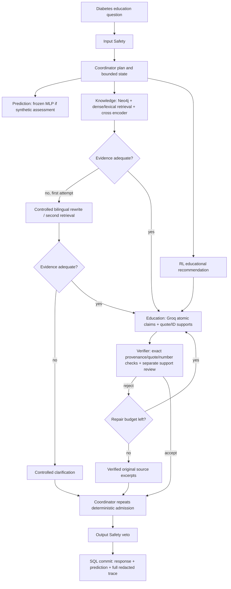

# Diabetes LLM and evidence verification

LLM status: the system integrates Groq inference; it does **not train an LLM locally**. The MLP and educational Q-table were trained in previous phases and remain frozen. The sentence encoder and cross-encoder are reused upstream pretrained models, not project-trained diabetes models.

## Configure Groq

Create/edit the gitignored project `.env` yourself. Do not send keys in chat or put them in frontend variables. Configure actual DATABASE_URL/Neo4j settings as in the demo guide and then:

```dotenv
GROQ_API_KEY=REPLACE_WITH_YOUR_LOCAL_KEY
GROQ_MODEL=openai/gpt-oss-20b
GROQ_TIMEOUT_SECONDS=25
DIABETES_LLM_ENABLED=true
```

The model must support Groq strict JSON schema output. Model availability/account permissions may change; choose an active supported model, record its ID and reevaluate when changing it. Default output budget is 2,000 tokens, configurable via `GROQ_MAX_OUTPUT_TOKENS`. The API key is a SecretStr and is never returned by readiness. Restart backend after changing configuration. Neither a configured key nor valid JSON is proof of a correct medical answer.

`/api/v2/system/readiness` reports unavailable → configured_unverified → available only after an actual successful provider response. With `DIABETES_LLM_ENABLED=false`, the provider is explicitly disabled. A failed/truncated/rate-limited provider response falls back to verified source excerpts; its body is not leaked. There is no fake local provider or automatic retry with an unapproved alternate model.

## Publication pipeline

GPT-OSS requests explicitly use `reasoning_effort=low` and `include_reasoning=false`, retaining strict JSON-schema output and all local validation. A real local-setup probe initially received `json_validate_failed`; after this configuration change, both generation and separate review returned HTTP 200. Provider JSON rejection remains a sanitized `GROQ_STRUCTURED_OUTPUT_REJECTED` fallback condition; rejected body/reasoning is never published. This was checked with actual public-source calls, not a mock. See [local environment verification](validation/local_environment/report.md). A connectivity smoke test is separate from the six-question model evaluation. [Groq GPT-OSS reasoning parameters](https://console.groq.com/docs/reasoning).



Claims are rendered from validated structured fields; model-written surrounding prose is forbidden. A source URL is obtained from admitted metadata, not invented by the LLM. A matching ID alone is insufficient: quote containment, source snapshot/version, parent section context, numeric support and separate semantic review are required for generated claims. Author-produced `grounded=true` is not an accepted input. The Coordinator rechecks deterministic publication rules even if an agent falsely reports approval.

Semantic review is another model call with a separate role/prompt; it is not independent human truth. It can make mistakes, especially with translation, scope, causality and population restrictions. Its acceptance rate is not clinical accuracy. Public education claims and trace examples need human source review before any clinical use. Raw English source excerpts may remain English when no LLM is available; the UI explicitly labels this mode.

RL output remains a whitelisted educational recommendation. The response renderer records proposed action, actual effective action and an override reason when verified source-only response mode takes priority. It does not claim a comprehension question was asked if the actual response only displayed evidence. No clinical action, online learning or health-outcome optimization is introduced.

When the first retrieval is inadequate, the second uses a fixed natural-language question for the detected diabetes topic, in both dense candidate retrieval and cross-encoder ranking. It does not merely append keywords while ranking the unchanged question. No detected topic means clarification, not an invented topic. Composition and semantic review still receive the original question; a retry is not permission to answer a different question. Exact-source fallback has provenance verification, not a clinical or general semantic-relevance guarantee.

## Credentials, budget and failure behavior

The Groq endpoint is fixed HTTPS. There are no model-chosen external tools, arbitrary URL fetches or user Cypher. A normal generated answer uses composition + separate review; repair is capped at two drafts/four remote attempts per run. Missing key, HTTP 401/403/429, timeout, model mismatch, malformed JSON, truncation or context overflow have distinct sanitized codes. Complete drafts are never partially streamed before verification.

Prompts contain public evidence and a question with common email/phone/long-number patterns redacted. They never include raw assessment features, SQL credentials or API keys. This redaction is not a complete PHI detector. Only synthetic inputs belong in this research demo; no claim is made that arbitrary real patient messages are safe to send to a third-party provider. Trace stores only lengths, counts, codes, model/policy metadata and approved summaries.

## Verify actual remote behavior

```powershell
# Requires your local .env/key, actual Neo4j corpus and configured environment.
python scripts/evaluate_diabetes_llm.py --live --limit 6
```

This makes at most six question evaluations, each with composition and independent review; billing depends on provider/model and usage. It writes actual tokens/latency and approved answers only. Rejected drafts are not written. Without key, the script writes `llm_live_status.json` with NOT_RUN and null quality metrics. Without any genuine model response, it creates no model-quality chart. Automated acceptance is reported separately from human/clinical correctness.

The full offline checker intentionally disables the provider for browser/demo runs and reports that fact. To add the bounded live step: `python scripts/check_diabetes_expansion.py --live-llm`. Running API integration tests with an explicit mocked transport verifies software boundaries only; those responses are never counted as real LLM experiments.

References: [Groq structured outputs](https://console.groq.com/docs/structured-outputs), [supported models](https://console.groq.com/docs/models), [data controls](https://console.groq.com/docs/your-data). Provider documentation was checked during implementation; account-specific availability still requires an actual call.
